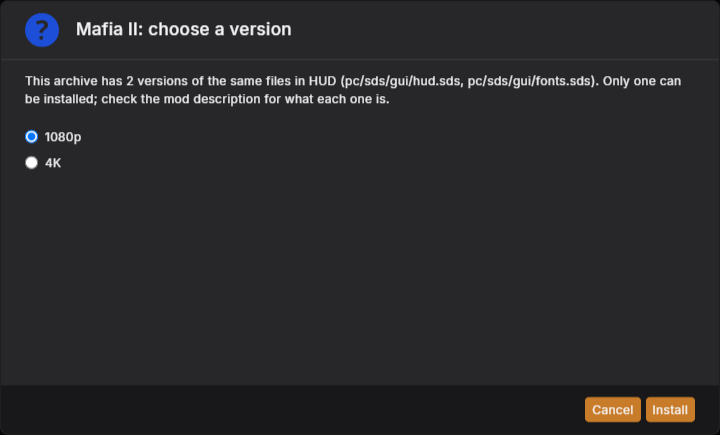
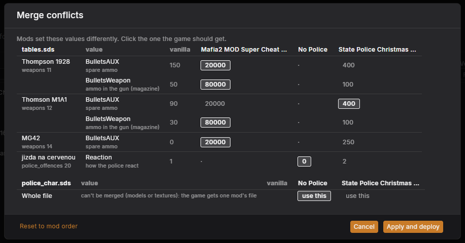
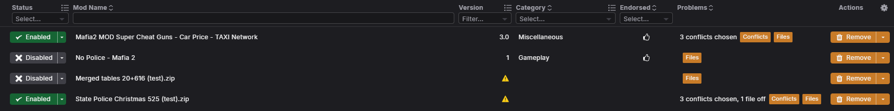
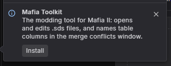

# Mafia II (Classic) support for Vortex

A [Vortex](https://www.nexusmods.com/about/vortex/) extension for Mafia II (2010, Classic, Steam 50130).
Not for the Definitive Edition.

[Nexus page](https://www.nexusmods.com/site/mods/2619)

## Features
- Game detection through Steam, launch via `pc/mafia2.exe`
- Installers for the layouts mods on [nexusmods.com/mafia2](https://www.nexusmods.com/mafia2) use:
  - `pc/` and `edit/` folders, also inside wrapper folders (screenshots and readmes are dropped)
  - `sds/` without its `pc/` parent goes under `pc/`
  - bare `.sds` files go where the game keeps the file of that name (`src/sds-paths.ts`);
    unknown names are refused with a message
  - archives with several versions of the same files side by side (`1080p/pc/...`, `4K/pc/...`):
    a dialog asks which one to install

    
  - ASI plugins and `dinput8.dll` go to `pc/`
- `.sds` files that several mods replace (`tables.sds`, `ingame.sds`, DLC files) are merged on deploy,
  field by field and resource by resource against the game's own file: two mods changing different
  fields of one weapon both apply. If two mods set the same field differently, the one lower in the
  mod list wins; the **Merge conflicts** window (Resolve in the notification, or ... on the Mods
  page) shows those values side by side and lets you pick one per field or a whole mod. Choices are
  kept (`mafia2-merge-choices.json` in the staging folder). Archives with models or textures can't
  be merged: one mod's file is used whole, the lower one in the list unless you pick another in
  the window. Once everything has a choice the notification turns green, and its **Change choices**
  button opens the same window.

  

- **Crash tracking.** While Mafia II is the active game, the extension notices when `mafia2.exe`
  exits and asks Windows whether it crashed. A run that ends without a crash, after the game wrote
  its `Saves` folder, is remembered with the enabled mods. When the game crashes, a notification
  names the mods added or changed since that run, with a button to disable them. If the mods are
  the same as in a run that worked, it says the crash is probably not caused by a mod. History is
  kept in `mafia2-crash-history.json` in the staging folder.
- **Problems column** on the Mods page, per mod:
  - *crashed since enabled*: the game crashed after the mod was enabled or changed (cleared by the
    next run that works; hover for the full text)
  - *N conflicts to resolve* / *N conflicts chosen*, with a **Conflicts** button that opens the
    Merge conflicts window
  - *N files off*, and on every mod a **Files** button: a list of the mod's `.sds` files with
    checkboxes. Unticked files are neither deployed nor merged, so the game gets its own copy or
    another mod's. To find the file that crashes the game, untick half, run the game, and narrow it
    down. This uses Vortex's own file overrides, so it survives restarts and shows in collections.

  
- Empty (0-byte) `.sds` files a deploy puts in the game are reported in a notification, and shown
  as *empty file (0 bytes)* in the Merge conflicts window. Some mods ship them on purpose to remove
  a model; if the game crashes, Files or the conflicts window can switch them off.

- [Mafia Toolkit](https://github.com/Greavesy1899/MafiaToolkit) is offered when the game is managed
  (also **Install Mafia Toolkit** under ... on the Mods page): it is downloaded from its GitHub
  releases into Vortex's folder, pointed at the game and added to the game's tools. Its list of
  column names fills in the names the conflicts window doesn't know. It needs the .NET 8 Desktop
  Runtime. It is not bundled: its licence doesn't allow redistribution.

  

## Build

Node 22+, pnpm.

```sh
pnpm install
pnpm test
pnpm run package   # out/mafia2-vortex-v<version>.zip
```

## Credits

The SDS reader/writer (`src/sds/`) is an independent TypeScript re-implementation based on the layout
and field names of [Gibbed.Illusion](https://github.com/gibbed/Gibbed.Illusion), Copyright (c) 2017 Rick
(gibbed), zlib License.

## License

GPL-3.0-or-later, see [LICENSE](LICENSE).
